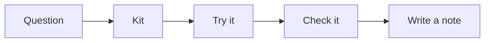

<picture>
  <source media="(prefers-color-scheme: dark)" srcset="assets/banner-dark.svg">
  
</picture>

I want to try new AI features on everyday BA work and write down what happens. This is where I'll keep short notes and honest verdicts, with the scoring decided before I start. I'm interested in whether the time saved holds up once checking and corrections are included.

## Notes

<!-- NOTES:START -->

**First note coming soon.** I haven't recorded a reviewed experiment yet. The kits and blank scoring sheets are ready; results are pending.

Next I'll [run a kit](#how-to-run-it), check the actual output and write up what happened.

<!-- NOTES:END -->

## What I want to try

| Kit | My question |
| --- | --- |
| [Local model](kits/local-model/) | How does a laptop model compare with a hosted model on requirements? |
| [CPS 230](kits/cps230-context/) | Does the whole standard or a few searched pages help more? |
| [Data dictionary](kits/data-dictionary/) | Which agent leaves less for me to correct? |
| [User stories](kits/structured-stories/) | How often does the answer match the required JSON format? |
| [Excel formulas](kits/excel-formulas/) | Can an agent edit a workbook and keep its formulas intact? |
| [Voice requirements](kits/voice-requirements/) | Which transcription errors change the requirements? |

The [backlog](BACKLOG.md) has the planned comparisons. Each kit includes inputs, a prompt and a blank scoring sheet.

## How I'll work through it



I'll use public or made-up inputs and set an acceptable error level before starting. I'll save the first answer, including failures, and count the time spent checking and fixing it. Then I'll compare it with the rule I set and link the evidence from my note.

## What the AI does / What checks it

| What the AI does | What checks it |
| --- | --- |
| Drafts requirements | I'll compare them with the input and score missing or invented rules |
| Answers questions about CPS 230 | I'll read the cited paragraphs in the saved edition |
| Produces user stories or a data dictionary | Scripts check the format and database columns; I'll check the meaning |
| Edits a workbook | A script compares cells and formulas; I'll recalculate totals and check formatting |
| Transcribes speech | A script counts word errors; I'll check important facts and requirements |

## How to run it

Install [uv](https://docs.astral.sh/uv/getting-started/installation/), then run these from the repository folder. It installs the Python packages as needed.

Copy the blank note template into a local draft folder. Fill it after a real experiment.

```sh
uv run python -m scripts.prepare note --out runs/first-note
```

Start the user-stories kit with its inputs and blank scoring forms, then follow its [steps](kits/structured-stories/README.md) to get and check real answers.

```sh
uv run python -m scripts.prepare kit structured-stories --out runs/stories
```

After writing and checking a real note in `notes/`, update the notes table above.

```sh
uv run python -m scripts.build_index
```

Use a fresh folder for another attempt. The [run guide](docs/RUNNING.md) covers saving answers and sharing evidence.

## Data

The fictional inputs use this repository's [MIT licence](LICENSE). The [CPS 230 kit](kits/cps230-context/) downloads a public APRA standard, which has its own [copyright terms](https://www.apra.gov.au/copyright). Downloaded PDFs stay in `data/raw/`; recordings and raw answers stay in `runs/`. Neither folder is published. I'll check anything going into [evidence/](evidence/README.md) before sharing it.

## Repo layout

```text
notes/        Dated notes, currently empty
evidence/     Shareable outputs and scores, once reviewed
TEMPLATE.md   Blank note template
BACKLOG.md    Planned comparisons
kits/         Inputs, prompts and scoring guides
scripts/      Preparation and checking tools
docs/         Run guide and blank run record
assets/       Light and dark banners
```

## About this repo

This first version was built with AI coding assistants. The results come from the code in this repo.

## Under the hood

The [scripts](scripts/) save answers and model details, check measurable parts of the output and update the notes table. There are some automatic checks in `tests/` to make sure the scripts work.
