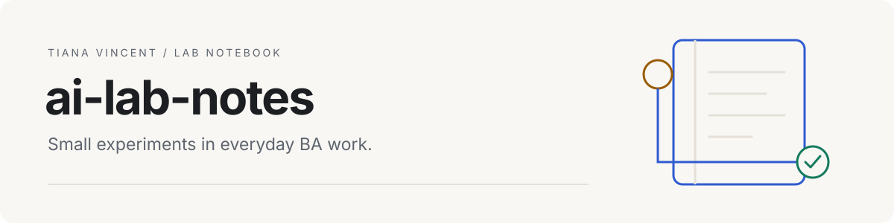
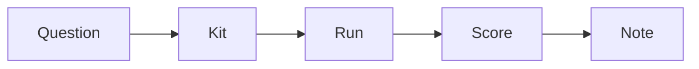

<picture>
  <source media="(prefers-color-scheme: dark)" srcset="assets/banner-dark.svg">
  
</picture>

AI features arrive faster than it is possible to judge them. This notebook is a place to try them on business analysis work, keep the evidence and write a short, dated note about whether they help. Each experiment starts with a question, a small task and a scoring sheet.

## How I run an experiment



Choose a kit and decide how to score it before running anything. Keep the input and prompt fixed when comparing tools. Save the actual output, model details and time spent, then run the kit's checks. Write the note after reviewing the evidence, including anything the checks could not establish.

## Notes

<!-- NOTES:START -->

**First note coming soon.** The experiment kits and scoring sheets are ready. Experiment results are pending.

Run a [kit](BACKLOG.md), score the actual output, then write a note using [TEMPLATE.md](TEMPLATE.md). Run `make results` to refresh this index and its charts.

<!-- NOTES:END -->

<!-- TIANA: write the first note before publishing -->
<!-- TIANA: run the chosen kit, complete its human scoring fields and retain the actual outputs before making any claims -->

## Backlog

- [Local model on a laptop](kits/local-model/): how much quality is lost compared with a hosted model on fictional meeting material?
- [CPS 230: long context or search](kits/cps230-context/): which approach answers questions about a public standard more accurately?
- [Copilot agent mode and Claude Code](kits/data-dictionary/): how do they compare on the same data dictionary task?
- [Structured user stories](kits/structured-stories/): can a model produce valid JSON against a fixed schema on every trial?
- [Editing an Excel workbook](kits/excel-formulas/): can an agent make the requested changes and preserve the formulas?
- [Voice memo to requirements](kits/voice-requirements/): how does transcription handle an Australian voice, and what carries through to requirements?

The [backlog](BACKLOG.md) records the planned comparisons. Each kit has inputs, instructions and a scoring sheet with no results filled in.

## Rules I follow

- Use public or made-up data only. Keep employer, client and personal material out.
- Decide the scoring criteria before the run. Keep failures and missing trials visible.
- Record the tools, versions, model identifiers, prompts and run conditions.
- Check outputs with code or source evidence, then record the human judgement separately.
- Leave results pending until there is evidence. Write notes after doing the experiment.

## What the AI does / What checks it

| What the AI does | What checks it |
| --- | --- |
| Drafts requirements from fictional inputs | A person compares each statement with the input and scores it against the kit rubric |
| Answers questions about a public standard | A person checks the cited paragraphs in the recorded edition |
| Produces JSON user stories and a data dictionary | Schema validation and a comparison with the input database structure |
| Edits a workbook | Formula and cell comparison, followed by a person checking recalculated totals and formatting |
| Transcribes speech | Word error rate against a verified transcript, plus a check of important terms |

## Try it

Install [uv](https://docs.astral.sh/uv/getting-started/installation/) and a Python version matching [.python-version](.python-version). From this folder:

```sh
make setup
make results
uv run pytest
```

These commands build the index and test the harness. To produce experiment evidence, follow the exact commands in a [kit](BACKLOG.md). The [run guide](docs/RUNNING.md) covers model access, manual answers and saved metadata. No model account is needed for setup or tests.

## Data

The kit inputs are explicitly fictional and covered by this repository's [MIT licence](LICENSE). Synthetic responses used to test the harness live only in `tests/`. They are never notebook entries or experiment evidence.

The standard kit downloads [APRA CPS 230](https://www.apra.gov.au/standards/cps-230) from APRA and records its edition and SHA-256, a fingerprint of the exact file. APRA's [copyright terms](https://www.apra.gov.au/copyright) specify a Creative Commons Attribution licence, with exceptions for logos, the Coat of Arms and third-party material. The PDF is stored in ignored `data/raw/`, along with download metadata, and is not included in this repository. Voice recordings must be made for the experiment from the fictional reading script and remain local in `runs/`.

<!-- TIANA: confirm the chosen inputs and any excerpts or recordings are suitable for public sharing; check APRA's current terms before publishing excerpts -->

## Repo layout

```text
notes/          Your dated notes, initially empty
TEMPLATE.md     Front matter and writing prompts for a real note
BACKLOG.md      Planned questions and links to kits
kits/          Experiment inputs, prompts and blank scoring sheets
scripts/       Index builder, model backends and measurable checks
docs/          Shared run instructions and an experiment record template
tests/         Offline tests and clearly labelled synthetic fixtures
assets/        Light and dark banners; charts appear after notes exist
```

## About this repo

This repository was built with AI coding assistants. The index and charts come from the code and the notes in this repository; experiment claims belong in notes written after real runs and checks.
