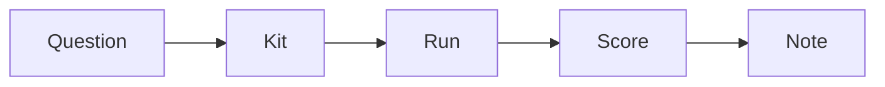

<picture>
  <source media="(prefers-color-scheme: dark)" srcset="assets/banner-dark.svg">
  
</picture>

I want to find out where AI saves me time on everyday BA tasks. I'll use this notebook to try a small task, keep the evidence and write a short, dated note about whether it helps. Each experiment starts with a question and a rule for acceptable errors and checking effort.

## How I run an experiment



For each experiment, I'll choose a kit and decide how to score it and what would make it useful before running anything. I'll keep the input and prompt fixed when comparing tools, save the actual output and model details, and include checking and correction time. After checking the evidence, I'll write the verdict and practical BA advice in a short note.

## Notes

<!-- NOTES:START -->

**First note coming soon.** The experiment kits and scoring sheets are ready. I haven't recorded a reviewed experiment yet, so results are pending.

Next I'll run a [kit](BACKLOG.md), check its output and write my first note using [TEMPLATE.md](TEMPLATE.md).

<!-- NOTES:END -->

## Backlog

- [Local model on a laptop](kits/local-model/): how do a local and a hosted model compare on requirement quality and effort using fictional meeting material?
- [CPS 230: long context or search](kits/cps230-context/): which approach answers questions about a public standard more accurately?
- [Copilot agent mode and Claude Code](kits/data-dictionary/): how do they compare on the same data dictionary task?
- [Structured user stories](kits/structured-stories/): can a model produce consistent user stories a team can load into a backlog tool, using JSON with a fixed schema?
- [Editing an Excel workbook](kits/excel-formulas/): can an agent make the requested changes and preserve the formulas?
- [Voice memo to requirements](kits/voice-requirements/): how does transcription handle an Australian voice, and what carries through to requirements?

The [backlog](BACKLOG.md) records the planned comparisons. Each kit has inputs, instructions and a scoring sheet with no results filled in.

## Rules for each experiment

- Use public or made-up data only. Keep employer, client and personal material out.
- Decide the scoring criteria and a rule for acceptable errors and correction effort before the run. Keep failures and missing trials visible.
- Record the tools, versions, model identifiers, prompts and run conditions.
- Check outputs with code or source evidence, then record the human judgement separately.
- Publish reviewed original outputs and completed scoring sheets in [evidence/](evidence/README.md), linked from each note.
- Leave results pending until there is evidence. Write notes after doing the experiment.

## What the AI does / What checks it

| What the AI does | What checks it |
| --- | --- |
| Drafts requirements from fictional inputs | A person compares each statement with the input and scores it against the kit rubric |
| Answers questions about a public standard | A person checks the cited paragraphs in the recorded edition |
| Produces JSON user stories and a data dictionary | Schema validation and a comparison with the input database structure |
| Edits a workbook | Formula and cell comparison, followed by a person checking recalculated totals and formatting |
| Transcribes speech | Word error rate against a verified transcript, plus a check of important terms |

## Try it

Follow the [run guide](docs/RUNNING.md) for setup, checks and running an experiment.

## Data

The kit inputs are explicitly fictional and covered by this repository's [MIT licence](LICENSE). Made-up responses used to test the checking tools live only in `tests/`. They are never notebook entries or experiment evidence.

The standard kit downloads [APRA CPS 230](https://www.apra.gov.au/standards/cps-230) from APRA and records its edition and SHA-256, a fingerprint of the exact file. APRA's [copyright terms](https://www.apra.gov.au/copyright) specify a Creative Commons Attribution licence, with exceptions for logos, the Coat of Arms and third-party material. The PDF is stored in ignored `data/raw/`, along with download metadata, and is not included in this repository. Voice recordings must be made for the experiment from the fictional reading script and remain local in `runs/`.

## Repo layout

```text
notes/          My dated notes, initially empty
evidence/       Reviewed original outputs and completed scoring sheets for each note
TEMPLATE.md     Front matter and writing prompts for a real note
BACKLOG.md      Planned questions and links to kits
kits/          Experiment inputs, prompts and blank scoring sheets
scripts/       Index builder, model backends and measurable checks
docs/          Shared run instructions and an experiment record template
tests/         Offline checks using made-up test inputs
assets/        Light and dark banners
```

## About this repo

This first version was built with AI coding assistants. The results come from the code in this repo.

## Under the hood

The [scripts](scripts/) save model responses, check measurable outputs and rebuild the notes table with `make results`. The [offline tests](tests/) use clearly labelled made-up inputs and never call a real model. CI runs those checks and flags an out-of-date notes table. Setup and verification commands are in the [run guide](docs/RUNNING.md#setup-and-checks).
